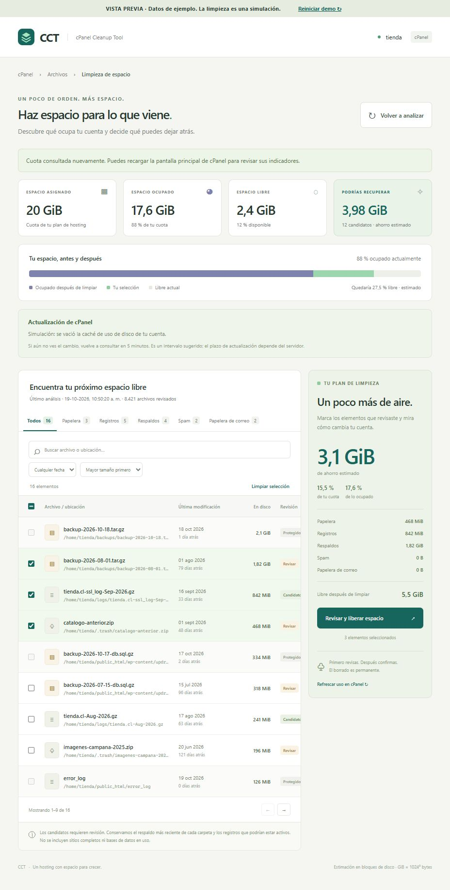
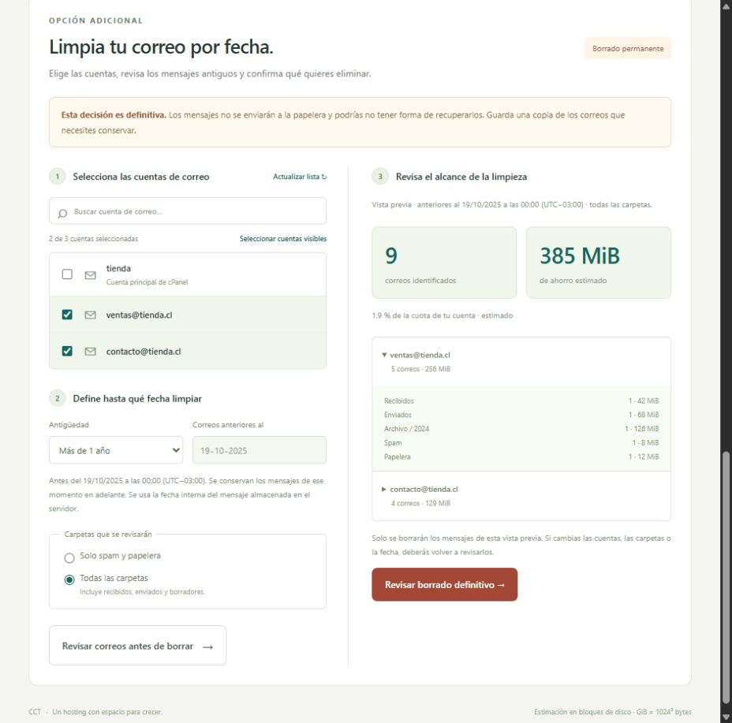

# CCT · cPanel Cleanup Tool

Plugin v0.2.1 para **cPanel con tema Jupiter**, instalado por el administrador de **WHM/root**. Cada cliente revisa únicamente su propia cuenta.

Muestra cuota asignada, espacio ocupado/libre y candidatos con nombre, ubicación, bloques ocupados y fecha de modificación. Al seleccionar elementos calcula al instante el ahorro estimado, su porcentaje de la cuota, su porcentaje del uso actual y el espacio libre proyectado. Después del borrado consulta nuevamente la cuota; no presenta el ahorro estimado como recuperación real verificada.

## Capturas de pantalla

Capturas de la **demostración con datos ficticios**. La limpieza es una simulación; estas imágenes no corresponden a cuentas ni a un servidor cPanel real.

| Revisión de espacio y selección de archivos | Limpieza de correos por cuenta y fecha |
| --- | --- |
| [](docs/screenshots/overview.jpg) | [](docs/screenshots/mail-cleanup.jpg) |

## Instalación desde GitHub

Repositorio: [denialhost/cpanel-cleanup-tool](https://github.com/denialhost/cpanel-cleanup-tool). Descargas: [versiones publicadas](https://github.com/denialhost/cpanel-cleanup-tool/releases).

Ejecuta como **root** en cada servidor cPanel/WHM con Jupiter y Python 3.9+:

```bash
curl --proto '=https' --tlsv1.2 -fsSL https://github.com/denialhost/cpanel-cleanup-tool/releases/download/v0.2.1/install-cct.sh -o /root/install-cct.sh
bash /root/install-cct.sh 0.2.1
```

El instalador descarga el paquete de esa versión, verifica su SHA-256 y lo instala. También permite actualizar una instalación existente: descarga el instalador de la versión nueva y ejecútalo con ese número. No hay actualizaciones automáticas. Durante una actualización conserva temporalmente la versión anterior y restaura sus archivos si falla el registro en cPanel.

En **WHM → Packages → Feature Manager**, busca **Limpieza de espacio Plugin** (identificador `cct`) y verifica que esté habilitado en las listas que corresponda; cPanel puede seleccionarlo por defecto al registrarlo. Cada cliente verá **cPanel → Archivos → Limpieza de espacio**. La instalación no analiza ni elimina datos de clientes.

Para elegir otro Python, usa `CCT_PYTHON=/usr/bin/python3.11 bash /root/install-cct.sh 0.2.1`. El instalador comprueba los requisitos antes de modificar la instalación y no instala dependencias del sistema.

Para desinstalar:

```bash
bash /usr/local/cpanel/base/frontend/jupiter/cct/uninstall.sh
```

## Vista previa local

```powershell
python preview.py
```

Abre <http://127.0.0.1:8765>. Usa datos ficticios y simula el borrado en memoria. No analiza ni elimina archivos del equipo. El botón **Reiniciar demo** repone los datos de ejemplo.

## Instalar en un servidor de prueba

Requisitos: Linux, cPanel & WHM con Jupiter, acceso root para instalar, Python **3.9+** y el Perl/LiveAPI incluido con cPanel. No hay dependencias de terceros ni claves API que configurar. La interfaz utiliza la sesión autenticada de cPanel.

```bash
tar -xzf cct-0.2.1.tar.gz
cd cct
bash install.sh
```

Si Python 3.9+ está en otra ruta:

```bash
CCT_PYTHON=/usr/bin/python3.11 bash install.sh
```

Habilita `cct` en **WHM → Packages → Feature Manager** para la lista de funciones del paquete correspondiente. Entra a una cuenta de prueba en **cPanel → Archivos → Limpieza de espacio**. La instalación requiere root; el CGI debe ejecutarse como el usuario autenticado de cPanel. Si el servidor lo ejecuta como root u otro usuario, el plugin rechaza la operación. No cambies este control para hacerlo funcionar.

El instalador registra el icono mediante `install.json` y `install_plugin`, y copia la aplicación a `/usr/local/cpanel/base/frontend/jupiter/cct/`. `bash uninstall.sh` retira únicamente el plugin.

**Estado de validación:** el cálculo, las reglas, el flujo de selección y la simulación se comprueban localmente. La integración con cpsrvd, permisos, Feature Manager, cuota real y Dovecot requiere una prueba en un servidor cPanel antes de ofrecerla a clientes. No hay un servidor cPanel conectado a este proyecto.

## Candidatos y límites

| Categoría | Qué se revisa | Protección |
| --- | --- | --- |
| Papelera | Archivos de `~/.trash/` | Selección y confirmación manual |
| Registros | Logs rotados reconocidos y comprimidos en `~/logs/` | Conserva logs recientes de menos de 7 días y archivos que podrían estar activos |
| Respaldos | Archivos de respaldo en carpetas reconocidas y respaldos cPanel `~/backup-*` | Conserva la ventana de 48 horas del conjunto más reciente por carpeta y los archivos con la misma fecha reconocida; exige aceptación adicional |
| Spam y papelera de correo | Mensajes indexados de carpetas directas `.spam`, `.Spam`, `.Junk`, `.Trash` | Solo Maildir v3 con GUID válido; borra por UID mediante UAPI, nunca con `unlink` |

Las heurísticas detectan **candidatos**, no garantizan que un archivo sea innecesario. Respaldos divididos pueden necesitar varias partes; deben revisarse como conjunto. El análisis general solo ofrece mensajes de spam y papelera. La sección adicional por fecha permite incluir recibidos, enviados, borradores y carpetas personalizadas al elegir explícitamente todas las carpetas. No se lee el cuerpo de los mensajes. Formatos `mdbox`, índices ausentes o formatos no reconocidos se omiten con aviso; se gestionan desde **Uso del disco de correo** de cPanel. Los buzones remotos no están cubiertos por esta versión.

El análisis tiene un presupuesto de 20 segundos, 150.000 entradas y 5.000 candidatos; las llamadas UAPI tienen un tiempo máximo adicional de 12 segundos cada una. Si no se puede completar, se informa **análisis parcial** y se protegen los respaldos. Esta versión no continúa análisis grandes por páginas. No incluye un tablero global multiusuario en WHM ni respaldos globales de `/backup`; estos no pertenecen a la cuota personal del cliente.

## Limpieza adicional de correos por fecha

La sección **Limpia tu correo por fecha** lista las cuentas de correo de la cuenta cPanel, incluida la principal. Permite seleccionar varias cuentas, elegir **más de 1 mes**, **más de 1 año** o **antes de una fecha**, y revisar cuántos mensajes se identificaron y qué espacio podrían liberar por cuenta y carpeta. Los períodos usan meses y años de calendario, ajustando los días que no existen al final del mes.

La fecha límite es **exclusiva**, al inicio del día en el huso del navegador; si un cambio de horario omite la medianoche, se utiliza la primera hora válida de ese día. Se muestra la hora y el desplazamiento UTC del corte, que quedan fijados para toda la operación. Se conservan los mensajes de ese momento en adelante. Se utiliza la fecha interna IMAP del mensaje, que Dovecot almacena como `mtime` en Maildir, y no el encabezado Date del remitente ni la última lectura. El backend construye una consulta `UID ... BEFORE <instante>`; no acepta consultas Dovecot libres del navegador.

El alcance inicial es **solo spam y papelera**. La opción **todas las carpetas** incluye recibidos, enviados, borradores, archivos y otras carpetas. La ubicación física de las carpetas Maildir++ se resuelve mediante GUID, incluyendo nombres personalizados o codificados. Otros formatos o índices no disponibles se informan como omitidos.

Antes de borrar se exige una vista previa en la interfaz. Cambiar las cuentas, la fecha o el alcance la invalida. La confirmación enumera cuentas y carpetas, exige escribir **ELIMINAR CORREOS**, aceptar que la pérdida puede ser irrecuperable y, si corresponde, confirmar por separado que se incluyen todas las carpetas. **Los mensajes se eliminan definitivamente, no se mueven a la papelera y el plugin no genera un respaldo.**

Se revalidan la pertenencia de las cuentas, los identificadores y el estado de cada mensaje al borrar. Solo se envían los UIDs identificados en la vista previa, en lotes de 250; no se incluyen mensajes nuevos que aparezcan mientras el cliente revisa. Las vistas previas parciales lo indican expresamente y solo abarcan los mensajes identificados; para continuar se vuelve a analizar. El refresco de caché y la nueva consulta de cuota se conservan después de esta limpieza.

## Cálculo de espacio

- La cuota proviene de `Quota/get_quota_info`, incluyendo `megabyte_limit` y `megabytes_used`, normalizados a bytes. No se utiliza el espacio libre de la partición como cuota del cliente.
- `libre = max(0, cuota − ocupado)`.
- `ahorro estimado = suma(st_blocks × 512)` de los archivos seleccionados. Los enlaces duros quedan protegidos y no suman ahorro. La estimación de archivos dispersos utiliza bloques asignados, no su tamaño lógico.
- `% de cuota = ahorro / cuota × 100`; `% de uso = ahorro / ocupado × 100`.
- `libre proyectado = max(0, cuota − max(0, ocupado − ahorro))`. Una cuenta que supera su cuota debe recuperar el exceso antes de mostrar espacio libre.
- Si cPanel no informa un límite finito, el porcentaje y libre proyectado de cuota quedan sin dato. Un límite cero puede representar cuota ilimitada o cuotas desactivadas.
- Después de eliminar se muestran por separado los elementos eliminados y el cambio observado en la cuota. La actualización de cPanel puede tener retraso y otras actividades simultáneas pueden modificar el uso. Archivos abiertos, compresión, bloques compartidos y diferencias del sistema de cuotas pueden hacer que la recuperación real difiera de la estimación.

### Refresco de caché de cPanel

Después de una eliminación, CCT intenta vaciar la caché de uso de disco **de esa cuenta** mediante `DiskUsage::clearcache` y vuelve a leer la cuota. También ofrece **Refrescar uso en cPanel**. Se utiliza API 2 a través de la conexión LiveAPI: esta función documentada pertenece a API 2, deprecada, y cPanel indica que no hay equivalente UAPI. Si no está disponible o la función está deshabilitada, el borrado ya completado sigue informado y aparece un aviso.

La respuesta distingue **caché vaciada**, **vaciado en curso** y **refresco no disponible**. Vaciar la caché no garantiza que todos los contadores, buzones o el panel lateral se hayan recalculado. El aviso sugiere volver a consultar en **5 minutos**, identificado como intervalo de comprobación, no plazo máximo garantizado. No hay un tiempo general documentado aplicable a todas las vistas; el ciclo de cuatro horas documentado para la caché de bases de datos no se aplica como promesa a esta limpieza de archivos. No se ejecutan `fixquotas` ni reconstrucciones globales.

## Controles del borrado

Las solicitudes requieren POST JSON, cabecera propia y origen coincidente. El backend obtiene la cuenta del usuario efectivo del proceso, verifica la función `cct` y vuelve a analizar antes de borrar. Ignora rutas fuera del hogar, enlaces simbólicos, archivos de otro propietario, elementos protegidos y selecciones cuyo tamaño, inode, fechas u otro identificador haya cambiado. Recorre rutas con descriptores de directorio y `O_NOFOLLOW`. No acepta una ruta de hogar enviada por el navegador y no ejecuta comandos mediante una shell.

La confirmación enumera los elementos concretos y exige escribir **ELIMINAR**. Las operaciones se dividen en lotes de 250 elementos. No hay limpieza automática. Los fallos parciales se informan individualmente. Los mensajes se identifican por GUID de buzón, UID y UIDVALIDITY validada en el nuevo análisis; el borrado usa la consulta Dovecot `UID` y se comprueba la desaparición del archivo. No se envía una consulta `ALL`. Cambios concurrentes en los índices o movimientos de mensajes pueden obligar a repetir el análisis; no se bloquea el servicio de correo durante la operación.

El análisis no crea inventarios ni archivos temporales dentro de la cuenta, para poder trabajar cuando la cuota está llena. Los datos permanecen en el servidor y el navegador; no hay telemetría ni recursos externos.

## Conexión con cPanel y actualización desde v0.2.0

La entrada `index.live.pl` inicia el módulo oficial `Cpanel::LiveAPI`, conecta una vez por solicitud y cierra la conexión antes de emitir la respuesta HTTP. El motor Python se comunica con esa entrada mediante dos tuberías privadas; las consultas UAPI y el refresco API 2 usan la misma sesión autenticada. No se ejecutan `uapi` ni `cpapi2` como subprocesos dentro de LiveAPI. La entrada anterior `index.live.cgi` se conserva como un acceso de compatibilidad al mismo puente.

La versión 0.2.0 no iniciaba la conexión requerida por la extensión `.live.cgi`. Esto podía producir `Child failed to make LIVEAPI connection to cPanel` y texto adicional detrás de la respuesta JSON. Actualiza a 0.2.1 con el instalador de esta página y vuelve a abrir el plugin desde el icono de cPanel. El instalador conserva las selecciones de Feature Manager; no necesitas desinstalar primero.

Las pruebas de integración usan el puente Perl y el motor Python reales con un módulo LiveAPI simulado. Comprueban la apertura y cierre de la conexión, la cuota, el refresco de caché, el rechazo de una función deshabilitada y que los errores devuelvan un único JSON. No sustituyen la validación en un servidor cPanel real.

## Comprobaciones

```bash
python -m unittest discover -s tests -v
node --test tests/model.test.mjs tests/mail-model.test.mjs
python -m py_compile plugin/cct_core.py plugin/cct_mail.py plugin/cct_backend.py plugin/cct_live.py preview.py
perl -c plugin/index.live.pl
bash -n install.sh uninstall.sh bootstrap.sh
python tools/package.py
```

La prueba de eliminación con descriptores y escape por symlink se ejecuta en Linux y se omite en Windows. En un servidor de prueba, verifica el aislamiento con dos cuentas distintas, acceso directo con la función deshabilitada, selección de correos reales de prueba, cuota antes/después, respaldos multipartes, archivos modificados durante el análisis y errores de permisos antes de desplegar.

## Publicar una nueva versión

Actualiza `VERSION`, la versión del backend y la demo, el valor predeterminado de `bootstrap.sh`, los ejemplos y `CHANGELOG.md`. Publica una release en GitHub con la etiqueta `v` seguida de esa versión, apuntando al commit revisado. GitHub Actions ejecuta las pruebas en Linux con Python 3.9 y 3.12 y adjunta `cct-VERSION.tar.gz`, `install-cct.sh`, `VERSION` y `SHA256SUMS` a esa release solo si pasan. La sección Actions muestra el resultado; espera a que termine antes de distribuir el enlace. El workflow de publicación requiere permiso `contents: write` únicamente en ese trabajo.

La integración con WHMCS para identificar servicios, cotizar aumentos y pagarlos está pendiente; no forma parte de esta versión.

## Referencias oficiales

- [Desarrollo de plugins cPanel y ubicación de archivos](https://api.docs.cpanel.net/guides/guide-to-cpanel-plugins/).
- [Registro mediante install.json](https://api.docs.cpanel.net/guides/guide-to-cpanel-plugins/guide-to-cpanel-plugins-add-plugins/).
- [install_plugin](https://docs.cpanel.net/whm/scripts/the-install_plugin-script/).
- [Entornos LiveAPI y extensión CGI para Python 3](https://api.docs.cpanel.net/guides/guide-to-the-liveapi-system/).
- [Cuota de la cuenta](https://api.docs.cpanel.net/specifications/cpanel.openapi/disk-quotas/quota-get_quota_info).
- [Vaciado de la caché de uso de disco por cuenta](https://api.docs.cpanel.net/cpanel-api-2/cpanel-api-2-modules-diskusage/cpanel-api-2-functions-diskusage-clearcache).
- [Uso del disco de correo](https://docs.cpanel.net/cpanel/email/email-disk-usage/).
- [Borrado de mensajes mediante UAPI](https://support.cpanel.net/hc/en-us/articles/10068378236439-How-to-delete-emails-older-than-X-days-with-the-UAPI).
- [Consultas Dovecot y selección por UID](https://doc.dovecot.org/main/core/man/doveadm-search-query.7.html).
- [Fecha interna y estructura Maildir](https://doc.dovecot.org/2.3/admin_manual/mailbox_formats/maildir/).
